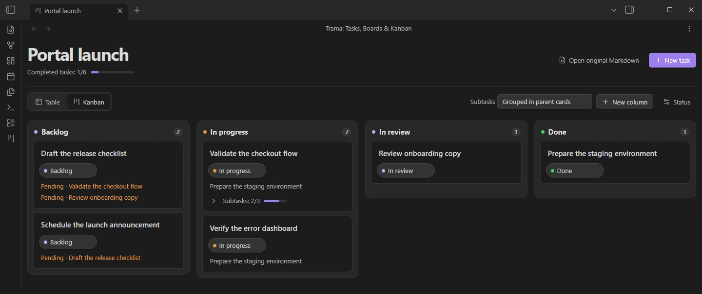
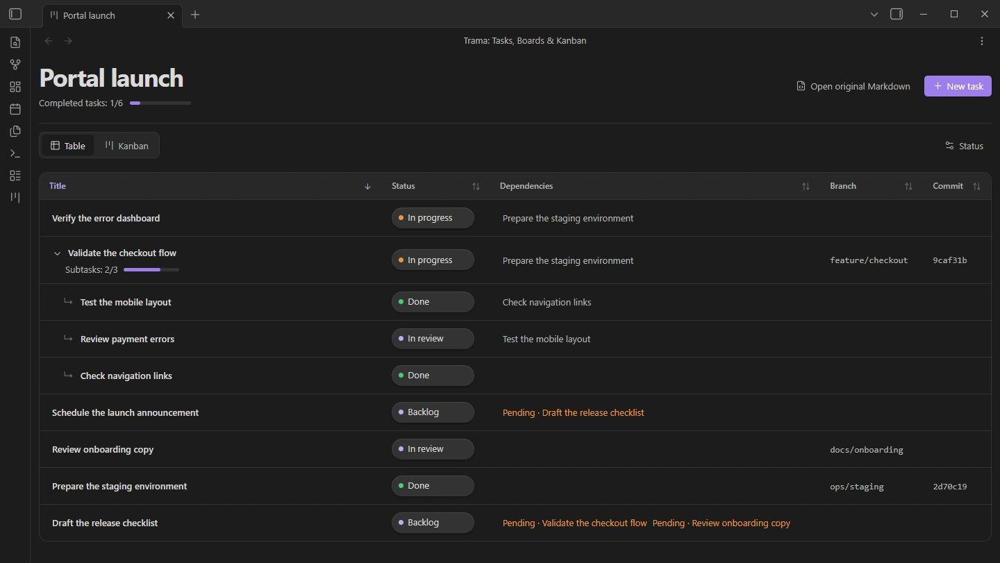
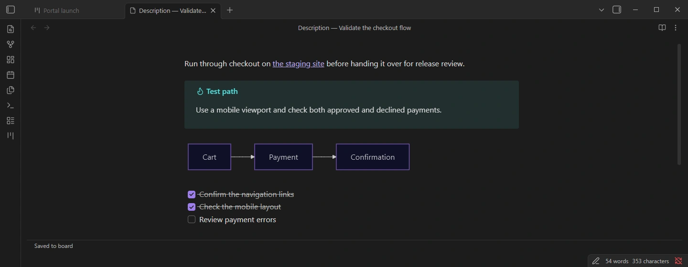

# Trama - Tasks and Kanban Boards

Trama is an Obsidian plugin for managing tasks and subtasks in **Table** and **Kanban** views. Each board is a single Markdown or JSON file in your vault, and task descriptions open in Obsidian’s native Markdown editor.

[Installation](#installation) · [Quick start](#quick-start) · [Working with a board](#working-with-a-board) · [Board files](#board-files) · [Development](#development)

## Installation

Trama requires Obsidian 1.8.7 or later.

When Trama appears in the community directory, open **Settings → Community plugins → Browse** and search for **Trama - Tasks and Kanban Boards**. Select **Install**, then **Enable**.

To install from a [GitHub release](https://github.com/LeGustaVinho/trama-obsidian/releases):

1. Download the three release assets `main.js`, `manifest.json`, and `styles.css`. To build them locally instead, run `npm ci` and `npm run build` with Node.js 22.13 or later, then collect the files from `dist/`.
2. Create `trama-tasks-boards-kanban` inside your vault’s `.obsidian/plugins/` directory. If your vault uses a custom configuration folder, use that folder in place of `.obsidian`.
3. Copy all three files into that plugin folder.
4. In Obsidian, open **Settings → Community plugins** and enable **Trama - Tasks and Kanban Boards**. If Restricted Mode is on, turn it off first.

## Quick start

1. Open the command palette and search for **Trama**. Run **Create board**, enter a title, and choose **Markdown (.md)** or **JSON (.json)**.
2. Click **New task** to add your first task. Open it and use **Add subtask** to break the work down.
3. Switch between **Table** and **Kanban** at the top of the board. Use **New column** in Kanban to add a status, or open **Status** to rename, reorder, or remove statuses and choose which ones count as completed.

Click a board file to open it directly, or use the **Trama** icon in the left ribbon to search for boards. You can access the Markdown document with **Open original Markdown** and the JSON file with **Open source**.

To try populated boards, copy the entire examples folder into your vault so the sample notes and image stay beside the board files. The Markdown and JSON examples can coexist in the same vault. [Examples folder](docs/examples/) · [Markdown board](docs/examples/board-md.md) · [JSON board](docs/examples/board-json.json)

## Working with a board

### Table and Kanban

In **Table**, click a column header to cycle through ascending order, descending order, and the order stored in the board. Expand a task to see its subtasks. The progress bar shows how many of its subtasks are in a completed status.

In **Kanban**, drag a card by its heading to move it to another status. Subtasks can stay grouped beneath their parent or appear in their own status columns.

### Markdown descriptions

Open a task or subtask, then click **Open description** to edit it in an Obsidian tab. Use Live Preview, Source mode, or Reading view with Obsidian Markdown features such as wikilinks, image embeds, callouts, and Mermaid diagrams. Edits save automatically to the board file. Relative links and images resolve from the board’s folder.

### Dependencies, Git, and archiving

- In **Edit details**, open **Select dependencies** to browse a searchable tree of tasks and subtasks. Search by title, parent task, or status. Use **Selected only** to review existing links. Arrow keys navigate and Space toggles the focused item.
- Record a Git branch and commit on any task or subtask. Use **Back to parent task** in a subtask’s details to jump back to its parent.
- **Archive** hides a task and its subtasks from the board while preserving the data and existing links. **Copy link** creates a link to an item in the vault. **Delete** removes the item, its subtasks if applicable, and dependency references to the deleted items.

## Board files

Both formats use the same versioned board model. Markdown stores the board structure in YAML frontmatter and descriptions in the note body. JSON stores the entire board as structured data with descriptions as Markdown strings.

| Resource | Purpose |
| --- | --- |
| [Board format specification](docs/board-format.md) | Field definitions, ID and dependency rules, and instructions for generating or editing boards with scripts or AI tools |
| [JSON Schema](docs/board.schema.json) | Machine-readable schema for the JSON format |

### Data and network access

Trama reads and writes boards locally in your vault and has no telemetry. When Obsidian renders a description that references an external image or web embed, it may contact the host specified in that Markdown to display the content.

If you used a development build that stored descriptions in separate draft notes, review any remaining draft notes in your vault. You can copy edits from those notes into the matching task description.

### Language

Trama follows the Obsidian display language and includes 51 language options. New boards get localized default statuses. Titles, descriptions, and custom status names are displayed as written in the board file. [Translation catalogs](src/locales/)

## Development

Run these commands from the plugin directory.

| Command | Purpose |
| --- | --- |
| `npm ci` | Install the locked dependencies |
| `npm run lint` | Check the source, manifest, and license with the official Obsidian ESLint plugin |
| `npm run check` | Type-check the plugin |
| `npm test` | Verify board formats, editing rules, and translation coverage |
| `npm run build` | Type-check and write the installable plugin files to `dist/` |

## License

Trama is distributed under the [MIT License](LICENSE). The build includes the copyright and license notices for Ajv, fast-deep-equal, and YAML in `main.js`.
