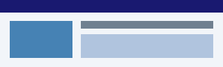
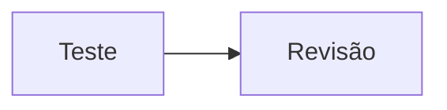

<!-- task-board:entrega-v1:avaliar -->
## Avaliar a entrega

Confira [[Contexto]] e a imagem.




<!-- task-board:entrega-v1:testar -->
### Testar navegação

> [!tip] Roteiro
> Teste os links do menu em uma janela estreita.

![[Contexto]]
<!-- task-board:entrega-v1:revisar -->
### Revisar resultados

Compare a saída com o arquivo de referência.

```text
status: aprovado
```
<!-- task-board:entrega-v1:preparar -->
## Preparar ambiente

Crie o ambiente de teste.
<!-- task-board:entrega-v1:prototipo -->
## Publicar protótipo

Protótipo entregue.
